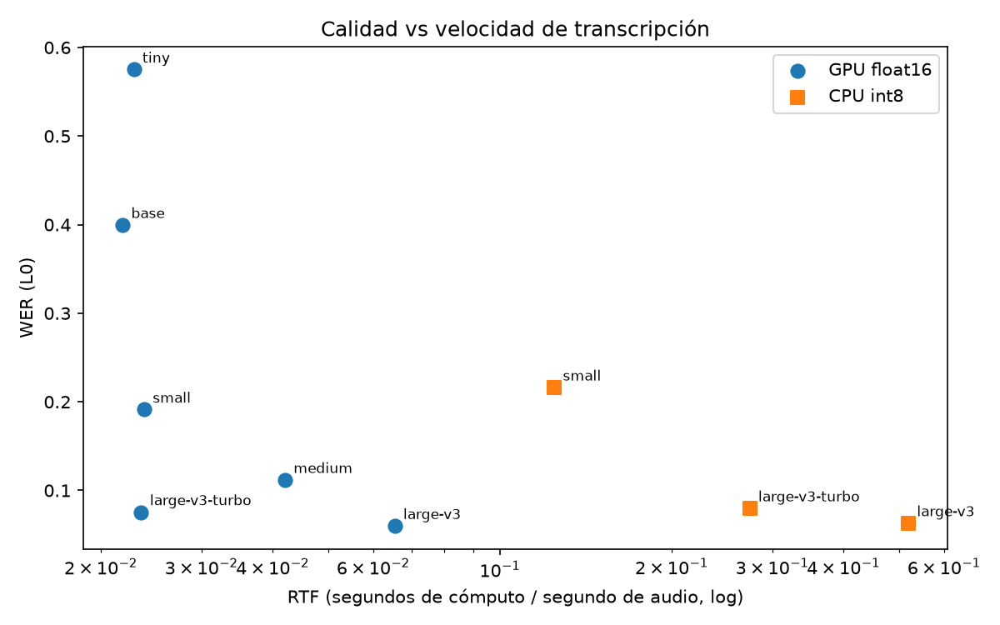
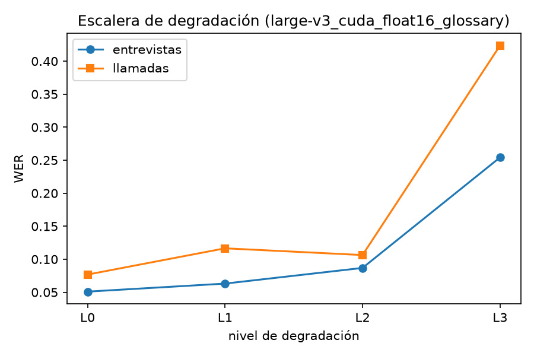
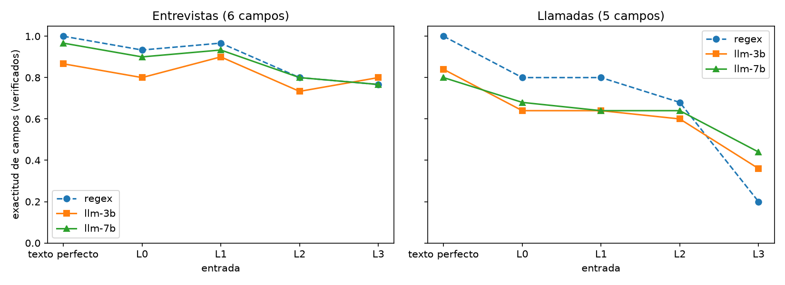

# voice_to_record

**From Voice to Record — Interview Intake and Sales Call Capture.** Real Spanish audio goes in,
a structured record comes out: **Whisper** (faster-whisper, on the GPU) transcribes, an extractor
(rules or a **local LLM**, Qwen 2.5) fills the fields, a **literal verification** rule blanks every
value that cannot be found in what was actually said, and for orders an **arithmetic validator**
checks the total and says whether the mistake was the person's or the transcriber's.

**Headline.** On the original recordings `large-v3` transcribes with **6.1 % WER** in **8 s per
clip** on an RTX 5050 laptop GPU, **8× faster than the CPU** with the same accuracy. The validator
**catches the 3 wrongly-said totals at every degradation level** (L0–L3) and, at L0, diagnoses all
three as *speaker error* with ASR confidence 0.95–0.99. What breaks the system is not the arithmetic
but the inputs to it: one degradation step (phone/WhatsApp + noise at 10 dB SNR) raises WER from 6 %
to **32 %**, and order-field accuracy falls from 68–80 % to 20–44 %.

## Problem

**What it does and for whom.** Two everyday voice workflows that end in a form someone types by hand:

- **Task 1 — Interview intake.** A recruiter's screening call becomes a candidate record:
  `anios_experiencia`, `ultimo_puesto`, `tecnologias`, `pretension_salarial`, `disponibilidad`
  (resolved to a date), `nivel_ingles`.
- **Task 2 — Sales call capture.** A phone order to a pizzeria ("La Buena Masa", 8-item menu)
  becomes an order: `items` (product, quantity, menu price), `promocion`, `direccion_entrega`,
  `metodo_pago`, `total_dicho` — plus a check that the total the seller said is right.

**Why it is hard.** People do not speak in fields. In this corpus the candidate corrects herself
("casi tres años… no, dos años y medio"), gives a range before the number ("entre nueve y diez mil…
diría nueve mil ochocientos"), says today's salary next to the expected one; the customer swaps and
removes items, asks about products she does not order, and the seller repeats the address wrong
(302 → 306, 1104 → 1404), misquotes a price ("pepperoni familiar 45", menu 49), corrects the total
on the fly ("85… 88") and, in three calls, says a total that does not add up. On top of that the
transcriber mishears exactly the words that carry the value: "Plin", "Yape", "TypeScript",
"tres mil trescientos".

## Corpus (own recordings)

| | Interviews | Calls |
|---|---|---|
| Clips | 5 (`interview_01–05`) | 5 (`call_01–05`) |
| Length | 2:14 – 2:46 | **1:38 – 1:53** |
| Speakers | the student + a classmate (one interviewer/seller, one candidate/customer) | same |

- Recorded 2026-11-01 on an iPhone (Voice Memos, AAC 48 kHz stereo) in a quiet room, from scripts
  written for this project with planted difficulties (`data/scripts/`). **All data are invented.**
- **Consent:** both speakers agreed to be recorded and to publish these clips for this course
  project. No synthetic or downloaded audio is used.
- **Known deviation:** the five calls are **shorter than the 2-minute minimum** (98–113 s). They were
  kept rather than re-recorded; every call still contains its full order flow.
- Speakers deviated from the scripts. The ground truth (`data/ground_truth/`) follows **what was said**:
  e.g. `interview_03` said "tres mil **trescientos**" (script: 3200), so the gold salary is 3300.
  Accidental human errors were kept as extra test cases (see `nota` in `calls.json`).

### Reference transcripts (how they were made)

WER needs the exact words spoken, and the speakers added and skipped words. References were built
**semi-automatically** (`tools/build_references.py`): start from the script; accept a change only
where two independent models (`large-v3` and `large-v3-turbo`) both hear the same difference; never
auto-change numbers, products, technologies, payment or address words. The 9 remaining
field-critical disagreements were resolved by a third transcriber (NotebookLM) and a whisper-small
pass, and documented one by one in `data/references/overrides.json`. One value stays uncertain: the
customer's apartment number in `call_04` (1104; transcribers disagree).
**Caveat:** because two of the references' judges are `large-v3` and `large-v3-turbo`, their WER is
somewhat optimistic; the comparison against `tiny/base/small/medium` is the fair one.

## Pipeline

```
audio ─► decode 16 kHz mono ─► [degrade L0–L3] ─► Whisper (faster-whisper, GPU) ─► transcript + word confidences
      ─► extractor (regex | Qwen 2.5 3B/7B local) ─► fields
      ─► literal verification ─► record (unverifiable values = "sin_verificar")
      ─► (calls) arithmetic validation + diagnosis ─► "cuadra" | "no_cuadra: error_hablante | error_asr"
```

- **One engine** — `src/engine.py: process(audio, task) -> {transcript, fields, verified, validation,
  device, elapsed, error}` — used by the app and every experiment; no UI imports.
- **`config.yaml`** holds every setting (model, device, precision, glossary, extractor, ladder);
  **`.env`** holds secrets (none are required: everything runs locally, no API key).
- **Device proof.** The device is read back at runtime (`asr.py`); a failed CUDA load falls back to
  CPU and the result says so. Every transcript JSON stores `device`, `gpu_name`, time and VRAM.
- **Normalization rule** (`src/text_norm.py`, applied to reference and hypothesis alike): lowercase;
  digits to Spanish words ("6.500" = "seis mil quinientos"); "uno"→"un"; accents removed (ñ kept);
  punctuation removed; CEFR codes ("C1") kept as one token. Fillers are kept (they were said).
- **Spoken numbers** (`src/numbers_es.py`): "nueve mil ochocientos" → 9800, "dos años y medio" → 2.5,
  "entre nueve y diez mil" → 9, 10000 (two numbers), "ochenta y cinco ochenta y ocho" → 85, 88.
- **Extractors.** `extract_regex.py`: keyword windows, "last value wins" for self-corrections,
  current salary excluded. `extract_llm.py`: Qwen 2.5 Instruct run locally (3B in bf16, 7B in 4-bit
  NF4 to fit 8 GB), greedy decoding, JSON only, one invented example per task. The LLM never decides
  prices (they come from the menu) nor dates (it copies the phrase, code resolves "en dos semanas"
  against the recording date) — small LLMs get both wrong.
- **Literal verification** (`verify.py`): a number must be spoken in the transcript, ≥80 % of a text
  value's words must appear, each technology/product must be named, a category word or synonym
  must appear. Otherwise → `sin_verificar`. Example: on the perfect transcript of `call_04` Qwen 7B
  "fixed" the total to 106 (the true sum) although the seller said 116 — 106 was never said, so the
  field is blanked instead of silently hiding the seller's mistake.
- **Arithmetic validation and diagnosis** (`validate.py`): total = Σ quantity × menu price − discount.
  If it differs from `total_dicho`: **`error_asr`** when the evidence is weak (total not verifiable,
  an item unverifiable, or Whisper's mean word probability on the total < 0.6) — *listen before
  charging*; otherwise **`error_hablante`** — *the transcript is solid, the person said a wrong total*.
  It also lists prices spoken that differ from the menu.

## Results

Hardware: Intel Core i7-13650HX (14 cores), 32 GB RAM, **NVIDIA RTX 5050 Laptop 8 GB**, CUDA 12.8,
Windows 11. All numbers are over the 10 clips (≈ 21 minutes of audio). Full tables in `output/tables/`.

### 1. Transcription: model, device, precision (L0, no glossary unless stated)

| Model | Device / precision | WER | WER interviews | WER calls | Term recall | s / clip | VRAM model |
|---|---|---|---|---|---|---|---|
| tiny | GPU fp16 | 0.575 | 0.506 | 0.685 | 0.18 | 2.8 | 96 MB |
| base | GPU fp16 | 0.400 | 0.380 | 0.430 | 0.33 | 2.7 | 160 MB |
| small | GPU fp16 | 0.191 | 0.164 | 0.235 | 0.57 | 3.0 | 576 MB |
| medium | GPU fp16 | 0.112 | 0.089 | 0.148 | 0.70 | 5.4 | 1.9 GB |
| large-v3-turbo | GPU fp16 | 0.075 | 0.065 | 0.092 | 0.78 | 3.0 | 2.0 GB |
| **large-v3** | **GPU fp16** | **0.060** | 0.048 | 0.079 | 0.84 | 8.4 | 3.7 GB |
| large-v3 | GPU int8_float16 | 0.066 | 0.057 | 0.081 | 0.87 | 8.6 | 1.9 GB |
| large-v3 | CPU int8 | 0.063 | 0.050 | 0.083 | 0.87 | 67.2 | — |



- **GPU vs CPU** (same model, CPU at its best setting int8 × 8 threads): `small` 5.3×, `large-v3-turbo`
  11.6×, `large-v3` **8.0× faster** on the GPU, with the same WER (±0.01).
- **Precision:** int8 halves the VRAM (3.7 → 1.9 GB) for +0.6 WER points and is **not faster** on this GPU.
- Calls are always harder than interviews (WER ≈ 1.5×): faster speech, two people overlapping, numbers.
- **Chosen config:** `large-v3`, fp16, glossary on (best WER; 8 s per 2-minute clip is fine for an
  after-the-call workflow). `large-v3-turbo` is the choice if latency matters (3 s, +1.4 WER points).

### 2. Domain glossary (paired over the 10 clips, bootstrap 95 % CI)

| Model | Metric | Without | With | Mean difference [95 % CI] |
|---|---|---|---|---|
| large-v3 | WER | 0.064 | 0.064 | 0.000 [−0.007, +0.008] |
| large-v3 | term recall | 0.840 | 0.885 | **+0.045** [0.000, +0.110] |
| large-v3-turbo | WER | 0.078 | 0.072 | −0.007 [−0.016, +0.001] |
| large-v3-turbo | term recall | 0.775 | 0.860 | **+0.085** [0.000, +0.180] |

The glossary (passed as Whisper's initial prompt) does not move overall WER but helps the words
that matter — technologies and product names — by 4.5–8.5 points. With 10 clips the interval
touches zero, so this is **suggestive, not proven**.

### 3. Degradation ladder (large-v3, fp16, glossary)

| Level | What | WER | WER interviews | WER calls | Term recall |
|---|---|---|---|---|---|
| L0 | original | 0.061 | 0.051 | 0.077 | 0.89 |
| L1 | WhatsApp-like voice note (Opus 16 kbps mono) | 0.084 | 0.063 | 0.117 | 0.86 |
| L2 | phone channel (300–3400 Hz, 8 kHz) | 0.094 | 0.087 | 0.106 | 0.81 |
| L3 | L1 + white noise at **measured** SNR 10.0 dB | **0.319** | 0.254 | 0.424 | 0.70 |



### 4. Records: field accuracy after verification

| Input | Interviews regex | Interviews Qwen 7B | Interviews Qwen 3B | Calls regex | Calls Qwen 7B | Calls Qwen 3B |
|---|---|---|---|---|---|---|
| perfect transcript | 1.00 | 0.97 | 0.87 | 1.00 | 0.80 | 0.84 |
| L0 | 0.93 | 0.90 | 0.80 | 0.80 | 0.68 | 0.64 |
| L1 | 0.97 | 0.93 | 0.90 | 0.80 | 0.64 | 0.64 |
| L2 | 0.80 | 0.80 | 0.73 | 0.68 | 0.64 | 0.60 |
| L3 | 0.77 | 0.77 | 0.80 | **0.20** | **0.44** | 0.36 |



- **Read the regex column with care:** the rules were written while looking at these ten transcripts,
  so on clean text they are tuned to this corpus (1.00 on perfect text is an upper bound, not a
  generalization). The LLMs saw no transcript of this corpus while their prompts were written —
  only invented examples. The fair reading is the **slope**: when audio degrades to L3, the rules
  collapse on orders (0.80 → 0.20) and Qwen 7B degrades more gracefully (0.68 → 0.44).
- **Qwen 7B vs 3B:** 7B is better on interviews at every level up to L2 and drops fewer order items
  (item F1 at L0: 0.97 vs 0.89 — 3B tends to forget the drinks); it costs 5.4 s vs 4.6 s per clip
  and 5.5 GB of VRAM in 4-bit.
- Per field (Qwen 7B, L0): years, salary, availability, English level 100 %; technologies 60 %
  (e.g. Whisper writes "Timescript" for TypeScript); payment method 60 % — **"Plin" and "Yape" are
  lost by the transcriber in 2 of 5 calls** and verification blanks the guess instead of inventing it.
- Salary is exact at every level except L2, where "tres mil trescientos" is heard as 3200
  (`interview_03`, off by 100) and `interview_04`'s salary is lost.

### 5. Arithmetic validation (3 calls with a wrong total, 2 correct)

| Extractor | Input | Caught | Missed | False alarms | Correct, no alarm |
|---|---|---|---|---|---|
| regex | L0 | 3 | 0 | 1 | 1 |
| Qwen 7B | L0 | 3 | 0 | 1 | 1 |
| Qwen 7B | L1 | 3 | 0 | 1 | 1 |
| Qwen 7B | L2 | 3 | 0 | 1 | 1 |
| Qwen 7B | L3 | 3 | 0 | 2 | 0 |

- **No wrong total ever escapes** (0 missed at any level, any extractor). At L0 the three are diagnosed
  `error_hablante` with ASR confidence 0.95, 0.97 and 0.99 — correct: the sellers said 82, 76 and 116.
- **False alarms come from extraction, not arithmetic.** With Qwen 7B the alarm is `call_05`, where
  the seller said "85… 88": the model glued it into 85.88, verification blanked it, and the validator
  correctly answers "*sin_total → listen*", not "the seller is wrong". With the rules, `call_02` loses
  the pepperoni pizza (misheard) and the computed total drops to 32.
- At L3 several "catches" are `sin_total` (the total could not be read at all): the system asks for a
  human, which is the right behaviour, but it is not arithmetic catching the error.

## Run it

```bash
conda create -n voice python=3.11 && conda activate voice
pip install torch --index-url https://download.pytorch.org/whl/cu128   # GPU build
pip install -r requirements.txt
cp .env.example .env                                  # nothing is required in it

python src/degrade.py                                 # data/degraded/L0..L3
python experiments/run_asr.py benchmark               # models x device x precision x glossary
python experiments/run_asr.py ladder                  # chosen config on L0..L3
python experiments/run_records.py                     # regex, Qwen 3B, Qwen 7B -> verify -> validate
python experiments/report.py                          # output/tables, output/figures
streamlit run app.py
pytest -q tests                                       # also runs on every PR (GitHub Actions)
```

Transcripts and records are cached in `output/`, so the experiments re-run in seconds; delete a folder
to recompute it. The first run downloads Whisper models (~3 GB) and Qwen (6 GB / 15 GB).

## Repository

```
app.py                      Streamlit: process a clip (any model/device/level), results, corpus
config.yaml  .env.example   settings / secrets template
src/engine.py               the single engine (no UI)
src/asr.py                  faster-whisper wrapper: runtime device, time, VRAM peak, glossary
src/degrade.py              L0-L3 ladder with measured SNR
src/text_norm.py            WER normalization rule        src/numbers_es.py   spoken numbers
src/extract_regex.py        rules                         src/extract_llm.py  local Qwen
src/verify.py               literal verification          src/validate.py     arithmetic + diagnosis
src/metrics.py  src/scoring.py   WER/CER and record metrics
experiments/                run_asr.py, run_records.py, report.py
tools/                      reference building (transcribe_raw.py, build_references.py)
data/                       audio, manifest, scripts, references (+ overrides), ground truth
output/                     transcripts, records, metrics, tables, figures
tests/  .github/workflows/  rule tests, CI gate
```

## Limitations

- 10 clips, two speakers, one room: every number here has wide uncertainty and says nothing about
  accents, children, or real call-center audio. The calls are under the 2-minute minimum.
- References are semi-automatic (two-model agreement + documented overrides), not fully hand-checked.
- The regex extractor was developed on these transcripts; only its degradation slope is meaningful.
- L3 uses white noise; real background noise (traffic, voices) is structured and may hurt differently.
- No speaker diarization: "the address the customer said" vs "the seller's repetition" is left to the
  LLM, which sometimes takes the repetition (`call_04`: 1404).
- The diagnosis rule has two classes; extraction errors (a forgotten item) can still look like a
  speaker error. A third class, *check extraction*, is the obvious next step.
